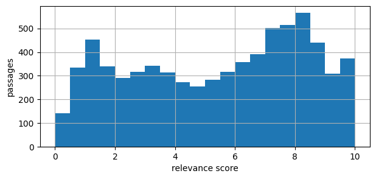
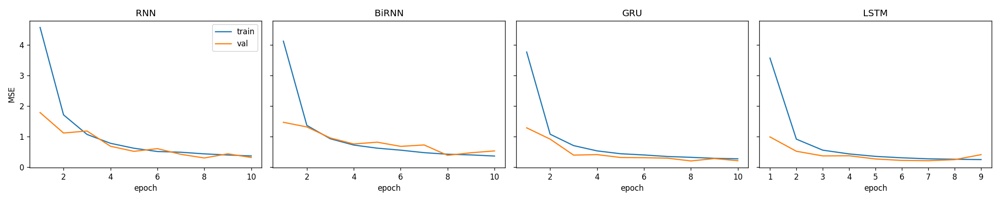
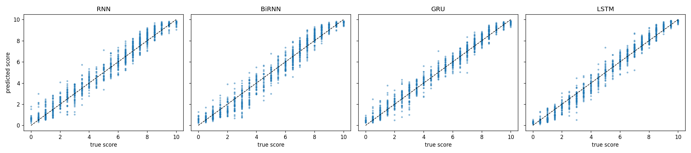
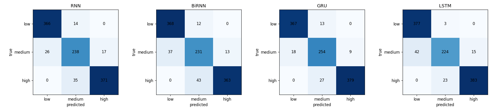

# Partie 1 : Classification de textes arabes avec RNN, BiRNN, GRU et LSTM

Dans cette partie, j'ai collecté des textes arabes sur un seul sujet, l'économie. J'ai donné à chaque texte un score de pertinence entre 0 et 10, puis j'ai entraîné quatre modèles récurrents avec PyTorch pour prédire ce score.

## Collecte des données

Pour le scraping j'ai utilisé requests et BeautifulSoup (`scraper.py`). J'ai d'abord testé plusieurs sites d'actualité arabes, mais certains bloquent les requêtes (Al Arabiya renvoie une erreur 403) ou chargent les articles en JavaScript. J'ai donc gardé Hespress et Al Jazeera.

Je n'ai pas pris que des articles d'économie. J'ai aussi récupéré des articles de sport, de culture et de société, sinon presque tous les textes auraient eu un score élevé. Au total j'ai 864 articles (722 de Hespress et 142 d'Al Jazeera). Je les ai découpés en passages de 40 à 120 mots, ce qui donne 7109 textes.

## Calcul du score

Comme il n'y avait pas de données annotées, j'ai calculé le score moi-même dans `build_dataset.py`. C'est la moyenne de deux valeurs. La première vient d'une liste de mots économiques (بورصة، تضخم، استثمار، ميزانية...) : plus le passage en contient, plus elle est élevée. La deuxième est une similarité TF-IDF qui mesure si le passage ressemble plus aux articles d'économie qu'aux autres. Le résultat est multiplié par 10 et arrondi à 0.5.

J'ai vérifié quelques exemples à la main. Le score dépend bien du contenu et pas seulement de la rubrique : un passage de sport qui parle du bilan financier d'un club de foot obtient 8.5, alors qu'un passage sur une enquête de police publié dans la rubrique économie obtient 2.

| Rubrique | Passages | Score moyen |
|---|---|---|
| économie | 3918 | 7.19 |
| société | 1134 | 3.64 |
| sport | 737 | 2.18 |
| culture | 1320 | 2.16 |



Le fichier final `data/dataset.csv` contient les colonnes `Text` et `Score` demandées. J'ai aussi gardé la rubrique, la source et l'url.

## Prétraitement

Le pipeline est dans `preprocessing.py`. Je commence par nettoyer le texte (liens, lettres latines, chiffres et ponctuation). Ensuite je normalise : je supprime les diacritiques et le tatweel, et je remplace أ إ آ par ا, ى par ي et ة par ه. Après la tokenisation, j'enlève les stop words avec la liste arabe de NLTK. Puis je fais la lemmatisation avec Qalsadi et le stemming avec ISRI (NLTK). Enfin, la discrétisation transforme le score en 3 classes : faible (moins de 4), moyen (de 4 à 7) et élevé (7 et plus).

Par exemple, `ارتفعت أسعار المحروقات في الأسواق المغربية` devient `ارتفع سعار محروق سوق مغرب`.

Pour les modèles j'ai utilisé les lemmes et pas les racines. Les racines de ISRI sont trop courtes et on perd le sens du mot (بورصة devient ورص).

## Modèles et entraînement

Les quatre modèles (`models.py`) ont la même structure, seule la couche récurrente change. Il y a d'abord une couche d'embedding de taille 128, puis la couche RNN, BiRNN, GRU ou LSTM, puis un pooling (moyenne et max) sur la séquence, et à la fin un petit MLP qui donne un score entre 0 et 10. J'ai traité le problème comme une régression avec la loss MSE.

Les données sont séparées en 70 / 15 / 15 (4976 / 1066 / 1067 textes). Le vocabulaire fait 6691 lemmes et les séquences sont coupées à 120 tokens. J'ai utilisé Adam avec lr = 0.002, un dropout de 0.3 et des batchs de 64, avec un early stopping (patience 2, 10 epochs maximum). Pour les hyperparamètres, j'ai testé la taille cachée (64 et 128) et le nombre de couches (1 et 2). J'ai tout entraîné sur le CPU de mon PC, donc j'ai gardé une petite grille. La recherche a pris environ 45 minutes.

RMSE sur la validation (en gras, la configuration gardée pour chaque modèle) :

| hidden / couches | RNN | BiRNN | GRU | LSTM |
|---|---|---|---|---|
| 64 / 1 | 0.762 | **0.626** | 0.501 | 0.685 |
| 64 / 2 | **0.553** | 0.877 | 0.557 | 0.486 |
| 128 / 1 | 0.687 | 0.682 | **0.457** | 0.757 |
| 128 / 2 | 0.576 | 0.863 | 0.504 | **0.465** |



## Résultats

Résultats sur le jeu de test :

| Modèle | RMSE | MAE | R² | Accuracy | F1 macro | BLEU-1 | BLEU-4 | Paramètres |
|---|---|---|---|---|---|---|---|---|
| RNN | 0.584 | 0.460 | 0.958 | 0.914 | 0.907 | 0.927 | 0.803 | 886K |
| BiRNN | 0.648 | 0.514 | 0.949 | 0.902 | 0.894 | 0.923 | 0.784 | 898K |
| GRU | **0.495** | **0.381** | **0.970** | **0.937** | **0.933** | **0.947** | **0.860** | 972K |
| LSTM | 0.498 | 0.390 | 0.970 | 0.922 | 0.913 | 0.933 | 0.820 | 1137K |

L'accuracy et le F1 sont calculés sur les 3 classes, après avoir discrétisé les scores prédits.





C'est le GRU qui donne les meilleurs résultats. Le LSTM est presque au même niveau en RMSE, mais le GRU est meilleur sur les classes, avec moins de paramètres et un entraînement plus rapide. Les deux modèles avec des portes sont nettement meilleurs que le RNN simple. Les passages font entre 70 et 100 tokens, et les portes aident à garder l'information sur toute la séquence. Le BiRNN n'a rien apporté, et avec 2 couches il devenait instable et s'arrêtait très tôt.

Dans les matrices de confusion, toutes les erreurs sont entre deux classes voisines. Aucun modèle n'a confondu « faible » et « élevé ». La classe « moyen » est la plus difficile, ce qui est normal puisqu'elle est au milieu.

Il faut quand même dire que le R² de 0.97 est très élevé parce que le score a été calculé à partir des mots du texte. Les modèles apprennent donc en quelque sorte ma formule. Avec des scores donnés par des personnes, la tâche serait plus difficile.

Pour le score BLEU, c'est normalement une métrique de génération de texte, alors qu'ici le modèle prédit un nombre. Pour le calculer quand même, j'ai remplacé chaque prédiction par sa classe, découpé le test en groupes de 10 labels et comparé la séquence prédite avec la vraie. BLEU-1 est proche de l'accuracy, et BLEU-4 vérifie en plus si plusieurs labels de suite sont corrects. Pour cette tâche, le RMSE et le F1 restent plus parlants.

## Synthèse

Ce TP m'a montré que le scraping demande pas mal d'essais : chaque site a sa propre structure HTML et certains bloquent les robots. La création des labels a été aussi une vraie partie du travail, il fallait trouver un score qui a du sens et le vérifier sur des exemples. Pour l'arabe, le prétraitement est plus lourd qu'en anglais à cause des diacritiques, des différentes formes de alef et ya, et des préfixes collés aux mots (و، ال، ب). La normalisation et la lemmatisation réduisent beaucoup le vocabulaire.

Côté PyTorch, j'ai appris à utiliser les embeddings avec padding, `pack_padded_sequence` pour les séquences de longueurs différentes, le gradient clipping (sans lui le RNN simple était instable) et l'early stopping. J'ai vu aussi en pratique que GRU et LSTM sont bien meilleurs que le RNN simple sur des séquences longues, et que le GRU fait aussi bien que le LSTM avec moins de calcul.

## Exécution

```
pip install -r requirements.txt
python scraper.py
python build_dataset.py
python train.py
```

Le notebook `Part1_Classification.ipynb` contient le même code avec les sorties.
