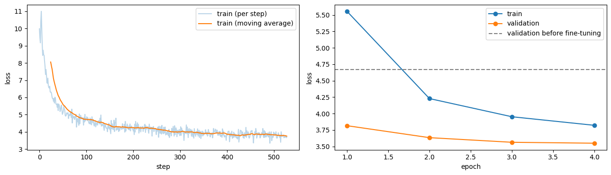

# Partie 2 : Fine-tuning de GPT-2 pour la génération de texte

Le but de cette partie est de prendre un GPT-2 pré-entraîné, de le fine-tuner sur mon propre dataset, puis de l'utiliser pour générer un paragraphe à partir d'une phrase. J'ai tout exécuté sur Kaggle avec un GPU Tesla T4. Le notebook `Part2_GPT2_FineTuning.ipynb` contient le code et toutes les sorties.

## Modèle

La librairie `pytorch-transformers` s'appelle maintenant `transformers` (Hugging Face), donc j'ai utilisé celle-là (version 5.20, avec PyTorch 2.11).

Comme mes textes sont en arabe, je n'ai pas pris le `gpt2` original mais [aubmindlab/aragpt2-base](https://huggingface.co/aubmindlab/aragpt2-base). C'est la même architecture GPT-2 (`GPT2LMHeadModel`, 12 couches, 135M de paramètres), mais pré-entraînée sur des textes arabes. Le GPT-2 anglais peut lire l'arabe, mais il découpe la phrase `ارتفعت أسعار المحروقات في الأسواق المغربية` en 67 tokens contre 7 pour AraGPT2, et il ne connaît presque rien de la langue.

## Dataset

J'ai repris le dataset de la partie 1 en gardant seulement les passages avec un score d'économie supérieur ou égal à 6. Ça fait 3453 passages venant de 505 articles, soit 212 353 mots (environ 61 mots par passage). J'ai séparé train et validation par article (90 / 10) pour que deux passages du même article ne se retrouvent pas des deux côtés. Comme dans le tutoriel, les passages sont collés avec le token `<|endoftext|>` puis découpés en blocs de 256 tokens. Ça donne 268 881 tokens pour l'entraînement (1050 blocs) et 30 089 pour la validation (117 blocs).

## Entraînement

J'ai écrit la boucle d'entraînement en PyTorch avec AdamW (lr = 5e-5, weight decay 0.01), un warmup linéaire sur 6 % des steps, la précision mixte fp16 et un gradient clipping à 1.0. J'ai utilisé des batchs de 8 sur 4 epochs. L'entraînement a pris 2,2 minutes sur le T4.

| | Loss validation | Perplexité |
|---|---|---|
| Avant fine-tuning | 4.673 | 107.1 |
| Epoch 1 | 3.816 | 45.4 |
| Epoch 2 | 3.633 | 37.8 |
| Epoch 3 | 3.563 | 35.3 |
| Epoch 4 | **3.549** | **34.8** |

La perplexité passe de 107 à 34.8, le modèle prédit donc environ 3 fois mieux ce type de texte. La loss de validation continuait à baisser à l'epoch 4, donc il n'y a pas d'overfitting et quelques epochs de plus auraient pu encore aider un peu.

Une chose m'a surpris au début : la loss d'entraînement commence vers 10 ou 11, alors que le même modèle avait une loss de 4.67 en validation avant l'entraînement. Une loss de 11, c'est presque ln(64000), c'est-à-dire un modèle qui choisit au hasard parmi les 64 000 tokens du vocabulaire. La seule différence entre les deux mesures, c'est le dropout, qui est actif en train et désactivé en évaluation. AraGPT2 a donc l'air très sensible au dropout, sûrement parce qu'il a été pré-entraîné sans. Il lui a fallu environ 150 steps pour s'adapter, et c'est aussi pour ça que la loss de train reste au-dessus de celle de validation sur la courbe. Mettre le dropout à 0 pendant le fine-tuning le ferait sûrement converger plus vite.

## Génération

Pour générer, j'ai utilisé l'échantillonnage avec top-k = 50, top-p = 0.95, une température de 0.8, une pénalité de répétition de 1.2 et `no_repeat_ngram_size=3`. J'ai mis la même seed avant et après le fine-tuning pour pouvoir comparer. Quelques exemples (les autres sont dans le notebook) :

Phrase : أعلن بنك المغرب أن معدل التضخم

- Avant : ... انتقل إلى 9 , 13 في المائة ، محققا بذلك ارتفاعا طفيفا عن مستوى 10 , 3 في المائة الذي سجلته نهاية شهر نونبر 2016 ...
- Après : أعلن بنك المغرب أن معدل التضخم بلغ 3,1 في المائة خلال غشت، مقابل تراجع قدره 2,51 في المائة بنهاية السنة الماضية.

Phrase : تسعى الحكومة إلى جذب الاستثمارات الأجنبية

- Avant : ... المباشرة ، خاصة بعد ارتفاع قيمة الودائع لدى البنوك في مصر لتصل إلى 2 . 8 مليار دولار ...
- Après : تسعى الحكومة إلى جذب الاستثمارات الأجنبية المباشرة في المغرب. وأوضحت وزارة الاقتصاد والمالية، أن هذا التطور يعكس قدرة السوق الوطنية على استقطاب رؤوس الأموال والاستثمارات الخارجية؛ ما يعزز تنافسية المشاريع التنموية القائمة على الاستثمار الأجنبي المباشر.

Phrase : يعاني الفلاحون من ارتفاع تكاليف الإنتاج

- Avant : ... في هذه المرحلة الحرجة التي تشهدها مصر بعد ثورة 30 يونيو ...
- Après : يعاني الفلاحون من ارتفاع تكاليف الإنتاج، خصوصا بالنسبة إلى منتجي البطاطس واللحوم؛ إذ تراجع سعر الكيلوغرام الواحد خلال يوليوز الماضي بنسبة 5,5 في المائة على أساس سنوي.

Après le fine-tuning, le style ressemble vraiment à celui de Hespress. On retrouve les mois marocains (غشت، يوليوز), « في المائة », le dirham, les institutions marocaines et même la façon d'écrire les nombres (3,1 au lieu de 9 , 13). Avant, 2 textes sur 5 partaient sur l'Égypte, et après ils restent tous au Maroc.

Par contre, les phrases sont correctes mais les chiffres sont inventés. Par exemple « ارتفعت أسعار المحروقات بأكثر من 17,6 مليار درهم » ne veut rien dire. Le modèle a appris comment on écrit l'actualité économique, pas les vrais faits. Les textes sont aussi devenus plus courts (une ou deux phrases). Les passages d'entraînement sont courts et séparés par `<|endoftext|>`, donc le modèle a appris à s'arrêter tôt. Pour avoir de plus longs paragraphes, on pourrait utiliser `min_new_tokens` ou entraîner sur les articles complets.

J'ai aussi comparé les méthodes de décodage avec la phrase `قال وزير الاقتصاد والمالية إن` :

| Méthode | Résultat |
|---|---|
| Greedy | “أما بالنسبة إلى المقاولات الصغيرة والمتوسطة، فإن هذا الوضع لا يعني بالضرورة أن يكون مرتبطا بحجم الاستثمارات التي يمكن تخصيصها في القطاع الخاص. |
| Beam search (5) | ارتفاع أسعار النفط إلى مستويات قياسية خلال الأشهر التسعة الأولى من السنة الجارية، ساهم في تقليص عجز الميزانية العامة بنسبة 3,5 في المائة، رغم استمرار المخاوف بشأن قدرة الاقتصاد على امتصاص الصدمات الخارجية. |
| Top-k (k = 50) | “في سياق حديث عن زيادة الرواتب، قال علي أن الزيادة المرتقبة خلال سنة 2026 ستكون مرتبطة أساسا بتحسين القدرة الشرائية للمواطنين. |
| Top-p (p = 0.92, T = 0.7) | “في سياق حديث عن آفاق نمو مستدام، فإن الحكومة تعمل على تقليص العجز إلى 4,4 في المائة خلال سنة 2025؛ ما يعكس تحسنا واضحا في توقعات النمو الاقتصادي. |

Le greedy donne une phrase assez générale et ouvre des guillemets qu'il ne ferme jamais. Le beam search donne la phrase la plus propre, qui ressemble le plus à un article. Le top-k est plus varié mais ajoute des détails au hasard (un certain علي). Le top-p avec une température plus basse est un bon compromis entre variété et cohérence.

## Synthèse

Cette partie m'a montré qu'on n'a pas besoin de beaucoup de données ni de temps pour adapter un modèle pré-entraîné. 270K tokens et 2 minutes sur un GPU ont suffi pour un modèle de 135M de paramètres, alors que l'entraîner depuis zéro serait impossible. Par contre, il faut choisir un modèle pré-entraîné dans la bonne langue, c'est pour ça que j'ai pris AraGPT2.

J'ai compris aussi comment marche le language modeling causal : on concatène les textes, on les coupe en blocs, et les labels sont les entrées elles-mêmes (le modèle les décale d'un token en interne). J'ai écrit une boucle d'entraînement complète avec AdamW, un scheduler, la précision mixte et le gradient clipping. Enfin, j'ai vu que les données influencent directement le résultat (la longueur des passages a donné la longueur des textes générés), qu'une bonne perplexité ne veut pas dire que le texte est vrai, et que la méthode de décodage change beaucoup le résultat. Il faut aussi faire attention à comparer des loss mesurées dans le même mode, train ou eval.

## Exécution

Sur Kaggle, il faut ajouter `Part1/data/dataset.csv` comme dataset au notebook, choisir le GPU T4, activer Internet pour télécharger le modèle, puis lancer toutes les cellules (environ 10 minutes).
