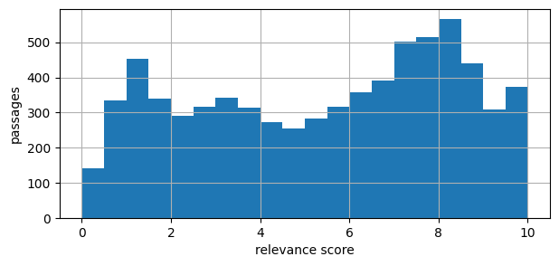
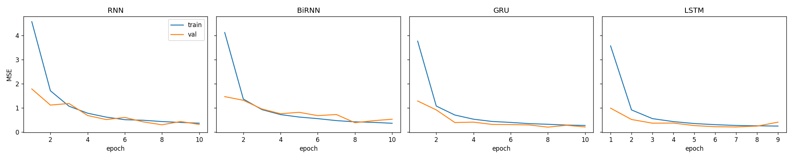
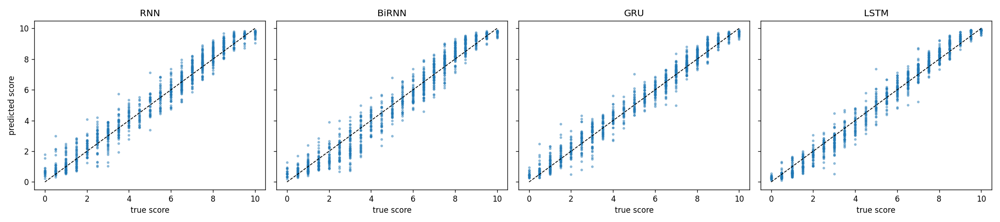
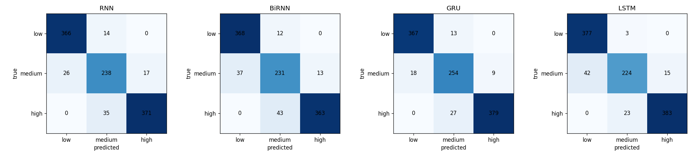
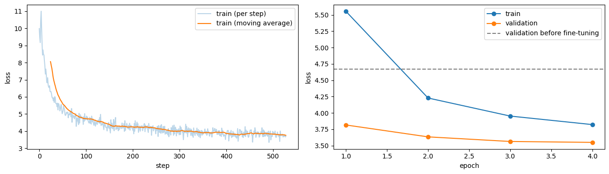

# TP 3 : Deep Learning pour le NLP avec PyTorch

Master MBD, FST Tanger. Module Deep Learning, Pr. ELAACHAK Lotfi.

L'objectif de ce TP est de se familiariser avec PyTorch et de construire des modèles de deep learning pour le traitement du langage naturel. Il y a deux parties. Dans la première, j'utilise des modèles séquentiels (RNN, BiRNN, GRU et LSTM) pour prédire la pertinence de textes arabes. Dans la deuxième, je fine-tune un modèle Transformer (GPT-2) pour générer du texte. J'ai choisi le même thème pour les deux parties : l'actualité économique en arabe.

## Organisation du projet

```
TD3/
├── README.md
├── Part1/
│   ├── scraper.py                  scraping des articles
│   ├── preprocessing.py            pipeline de prétraitement arabe
│   ├── build_dataset.py            découpage en passages et calcul du score
│   ├── models.py                   les 4 modèles (RNN, BiRNN, GRU, LSTM)
│   ├── train.py                    recherche d'hyperparamètres, entraînement et évaluation
│   ├── Part1_Classification.ipynb  le même code avec toutes les sorties
│   ├── requirements.txt
│   ├── data/                       articles bruts, dataset final et tokens
│   └── results/                    métriques, prédictions, figures et modèles entraînés
└── Part2/
    ├── Part2_GPT2_FineTuning.ipynb notebook exécuté sur Kaggle
    └── results/                    courbe de loss
```

# Partie 1 : Classification avec des modèles séquentiels

## 1. Collecte des données

Le TP demande de collecter des textes arabes sur un seul sujet à partir de plusieurs sites. Pour le scraping j'ai utilisé requests et BeautifulSoup (`scraper.py`). J'ai d'abord testé plusieurs sites d'actualité arabes, mais certains bloquent les requêtes (Al Arabiya renvoie une erreur 403) ou chargent les articles en JavaScript, donc on ne trouve rien dans le HTML. J'ai gardé Hespress et Al Jazeera, qui fonctionnent bien.

Le script parcourt les pages de chaque rubrique, récupère les liens des articles, puis télécharge chaque article et extrait le titre et les paragraphes. Chaque site a sa propre structure : sur Hespress le texte est dans `div.article-content` et sur Al Jazeera dans `div.wysiwyg`. Pour aller plus vite, les articles sont téléchargés en parallèle (6 threads), avec des timeouts et des nouvelles tentatives en cas d'erreur.

Je n'ai pas pris que des articles d'économie. Le score doit aller de 0 à 10, et si tous les textes parlaient d'économie ils auraient tous un score élevé. J'ai donc aussi récupéré des articles de sport, de culture et de société.

| Source | Rubriques | Articles |
|---|---|---|
| Hespress | economie (363), societe (119), sport (120), art-et-culture (120) | 722 |
| Al Jazeera | ebusiness (71), sport (35), culture (20), lifestyle (16) | 142 |

Les articles sont longs et de tailles très différentes, donc je les ai découpés en passages de 40 à 120 mots en regroupant les paragraphes. Au final j'ai 7109 passages.

## 2. Calcul du score de pertinence

Le dataset doit avoir deux colonnes, le texte et un score entre 0 et 10 qui représente sa pertinence par rapport au sujet. Comme il n'existe pas de données annotées, j'ai calculé ce score moi-même dans `build_dataset.py`. C'est la moyenne de deux valeurs entre 0 et 1.

La première est basée sur une liste de mots liés à l'économie (بورصة، تضخم، استثمار، ميزانية، ضريبة، بنك، صادرات...). Les mots importants comptent double, les mots plus généraux comme مليون ou نسبة comptent une fois. Je calcule la densité de ces mots dans le passage et je la transforme en valeur entre 0 et 1 avec la fonction 1 − exp(−8 × densité), comme ça la valeur ne dépasse pas 1 même si le passage contient beaucoup de mots économiques.

La deuxième est une similarité TF-IDF. Je calcule le vecteur moyen des passages de la rubrique économie et celui des autres rubriques, puis pour chaque passage je fais la différence entre sa similarité cosinus avec le premier et avec le deuxième. Le résultat est ramené entre 0 et 1.

Le score final est la moyenne des deux, multipliée par 10 et arrondie à 0.5. J'ai vérifié plusieurs exemples à la main pour voir si le score a du sens. Il dépend bien du contenu et pas seulement de la rubrique : un passage de sport qui parle du bilan financier d'un club de foot obtient 8.5, alors qu'un passage sur une enquête de police publié dans la rubrique économie obtient 2.

| Rubrique | Passages | Score moyen |
|---|---|---|
| économie | 3918 | 7.19 |
| société | 1134 | 3.64 |
| sport | 737 | 2.18 |
| culture | 1320 | 2.16 |



Les scores sont assez bien répartis entre 0 et 10. Le fichier final est `Part1/data/dataset.csv`, avec les colonnes `Text` et `Score`. J'ai aussi gardé la rubrique, la source et l'url.

## 3. Pipeline de prétraitement

Le pipeline est dans `preprocessing.py` et contient les étapes demandées.

Le nettoyage supprime les liens, les lettres latines, les chiffres et la ponctuation. Ensuite vient la normalisation, qui est importante en arabe parce qu'un même mot peut s'écrire de plusieurs façons : je supprime les diacritiques (tachkil) et le tatweel, et je remplace أ إ آ par ا, ى par ي, ة par ه, ؤ par و et ئ par ي.

Après la tokenisation, j'enlève les stop words avec la liste arabe de NLTK (754 mots). Ensuite je fais la lemmatisation avec Qalsadi, qui ramène chaque mot à sa forme de base (المحروقات devient محروق). Qalsadi est lent (environ 9 ms par mot), donc je garde les résultats dans un cache pour ne pas refaire le même mot plusieurs fois. Le stemming est fait avec ISRI de NLTK, qui donne la racine du mot.

Enfin, la discrétisation transforme le score continu en 3 classes : faible (moins de 4), moyen (de 4 à 7) et élevé (7 et plus). Ces classes servent à faire une séparation équilibrée des données et à calculer l'accuracy et le F1.

Exemple : la phrase `ارتفعت أسعار المحروقات في الأسواق المغربية` devient `ارتفع سعار محروق سوق مغرب` après le pipeline.

Pour les modèles, j'ai utilisé les lemmes et pas les racines. Les racines de ISRI sont trop courtes et on perd le sens du mot : par exemple بورصة devient ورص et المغربية devient غرب.

## 4. Les modèles

Les quatre modèles sont dans `models.py`. Ils ont tous la même structure, seule la couche récurrente change, comme ça la comparaison est juste.

1. Une couche d'embedding de taille 128 transforme chaque lemme en vecteur.
2. La couche récurrente lit la séquence : RNN simple, RNN bidirectionnel (qui lit dans les deux sens), GRU ou LSTM.
3. Un pooling calcule la moyenne et le maximum des sorties sur toute la séquence. J'ai obtenu de meilleurs résultats comme ça qu'en gardant seulement le dernier état caché, surtout pour le RNN simple qui oublie le début des longues séquences.
4. Un petit MLP donne la sortie, passée dans une sigmoïde multipliée par 10 pour avoir un score entre 0 et 10.

Les textes n'ont pas tous la même longueur, donc j'ai utilisé le padding avec `pack_padded_sequence`, pour que le modèle ne lise pas les tokens de padding. Comme le score est un nombre, j'ai traité le problème comme une régression avec la loss MSE.

## 5. Entraînement et choix des hyperparamètres

Les données sont séparées en 70 % train, 15 % validation et 15 % test (4976 / 1066 / 1067 passages), de façon équilibrée par rapport aux 3 classes. Le vocabulaire contient les lemmes qui apparaissent au moins 2 fois dans le train, soit 6691 tokens, et les séquences sont coupées à 120 tokens.

J'ai utilisé Adam avec un learning rate de 0.002, un dropout de 0.3 et des batchs de 64. J'ai ajouté un gradient clipping à 1.0, parce que sans lui le RNN simple devenait instable (explosion du gradient). L'entraînement s'arrête quand la loss de validation ne s'améliore plus pendant 2 epochs, avec 10 epochs au maximum, et on garde le meilleur modèle.

Pour les hyperparamètres, j'ai fait une recherche sur la taille de la couche cachée (64 et 128) et le nombre de couches (1 et 2), donc 4 configurations par modèle. J'ai tout entraîné sur le CPU de mon PC, donc j'ai gardé une petite grille. La recherche complète a pris environ 45 minutes.

RMSE sur la validation (en gras, la configuration gardée pour chaque modèle) :

| hidden / couches | RNN | BiRNN | GRU | LSTM |
|---|---|---|---|---|
| 64 / 1 | 0.762 | **0.626** | 0.501 | 0.685 |
| 64 / 2 | **0.553** | 0.877 | 0.557 | 0.486 |
| 128 / 1 | 0.687 | 0.682 | **0.457** | 0.757 |
| 128 / 2 | 0.576 | 0.863 | 0.504 | **0.465** |

On voit que le RNN simple s'améliore avec 2 couches, mais pas le BiRNN, qui devient instable et s'arrête très tôt avec une erreur élevée. Le GRU est déjà le meilleur avec une seule couche.



## 6. Résultats et évaluation

Le meilleur modèle de chaque architecture a été évalué sur le jeu de test, que les modèles n'ont jamais vu.

| Modèle | RMSE | MAE | R² | Accuracy | F1 macro | BLEU-1 | BLEU-4 | Paramètres |
|---|---|---|---|---|---|---|---|---|
| RNN | 0.584 | 0.460 | 0.958 | 0.914 | 0.907 | 0.927 | 0.803 | 886K |
| BiRNN | 0.648 | 0.514 | 0.949 | 0.902 | 0.894 | 0.923 | 0.784 | 898K |
| GRU | **0.495** | **0.381** | **0.970** | **0.937** | **0.933** | **0.947** | **0.860** | 972K |
| LSTM | 0.498 | 0.390 | 0.970 | 0.922 | 0.913 | 0.933 | 0.820 | 1137K |

Le RMSE et le MAE mesurent l'écart moyen entre le score prédit et le vrai score (un RMSE de 0.5 veut dire qu'on se trompe d'environ un demi-point sur 10). Le R² indique quelle part de la variation des scores le modèle explique. L'accuracy et le F1 sont calculés sur les 3 classes, après avoir discrétisé les scores prédits.



Pour les 4 modèles, les points sont proches de la diagonale, donc les prédictions suivent bien les vrais scores. Le RNN et le BiRNN sont un peu plus dispersés.



C'est le GRU qui donne les meilleurs résultats. Le LSTM est presque au même niveau en RMSE, mais le GRU est meilleur sur les classes, avec moins de paramètres et un entraînement plus rapide. Les deux modèles avec des portes (GRU et LSTM) sont nettement meilleurs que le RNN simple. Les passages font entre 70 et 100 tokens, et les portes aident à garder l'information sur toute la séquence, alors que le RNN simple a du mal avec les dépendances longues. Le BiRNN n'a rien apporté ici : lire le texte à l'envers n'aide pas beaucoup pour juger s'il parle d'économie, et il est plus difficile à entraîner.

Dans les matrices de confusion, toutes les erreurs sont entre deux classes voisines. Aucun modèle n'a confondu « faible » et « élevé ». La classe « moyen » est la plus difficile, ce qui est normal puisqu'elle est au milieu.

Il faut quand même dire que le R² de 0.97 est très élevé parce que le score a été calculé à partir des mots du texte. Les modèles apprennent donc en quelque sorte ma formule. Avec des scores donnés par des personnes, la tâche serait plus difficile et les résultats plus bas.

Pour le score BLEU, c'est normalement une métrique de génération de texte, qui compare les mots d'une phrase générée avec une phrase de référence. Ici le modèle prédit un nombre, donc il fallait l'adapter. J'ai remplacé chaque prédiction par sa classe (faible, moyen ou élevé), découpé le test en groupes de 10 labels et comparé la séquence prédite avec la vraie. BLEU-1 compare les labels un par un, il est donc proche de l'accuracy. BLEU-4 vérifie en plus si plusieurs labels de suite sont corrects. Pour cette tâche, le RMSE et le F1 restent plus parlants.

# Partie 2 : Transformer et génération de texte

## 1. Choix du modèle

Le TP demande d'installer pytorch-transformers et de charger GPT-2. Cette librairie s'appelle maintenant `transformers` (Hugging Face), donc j'ai utilisé celle-là (version 5.20, avec PyTorch 2.11). Cette partie a été exécutée sur Kaggle avec un GPU Tesla T4, parce que mon PC n'a pas de GPU.

Comme mes textes sont en arabe, je n'ai pas pris le `gpt2` original mais [aubmindlab/aragpt2-base](https://huggingface.co/aubmindlab/aragpt2-base). C'est exactement la même architecture GPT-2 (`GPT2LMHeadModel`, 12 couches, 135M de paramètres), mais pré-entraînée sur des textes arabes. Le GPT-2 anglais peut lire l'arabe, mais il découpe la phrase `ارتفعت أسعار المحروقات في الأسواق المغربية` en 67 tokens contre 7 pour AraGPT2, et il ne connaît presque rien de la langue.

## 2. Dataset

Le TP permet d'utiliser son propre dataset. J'ai repris celui de la partie 1 en gardant seulement les passages avec un score d'économie supérieur ou égal à 6, pour que le modèle apprenne à écrire des textes économiques. Ça fait 3453 passages venant de 505 articles, soit 212 353 mots (environ 61 mots par passage).

Pour le nettoyage, j'ai fait le minimum : suppression des liens, des diacritiques, du tatweel et des espaces en trop. Contrairement à la partie 1, j'ai gardé la ponctuation et les chiffres, parce que le modèle doit apprendre à écrire de vrais textes.

J'ai séparé train et validation par article (90 / 10), pour que deux passages du même article ne se retrouvent pas des deux côtés, sinon la validation serait trop facile. Comme dans le tutoriel, les passages sont collés avec le token `<|endoftext|>` puis découpés en blocs de 256 tokens. Ça donne 268 881 tokens pour l'entraînement (1050 blocs) et 30 089 pour la validation (117 blocs).

## 3. Fine-tuning

GPT-2 est un modèle de langage causal : il apprend à prédire le token suivant. Les labels sont donc les entrées elles-mêmes, c'est le modèle qui les décale d'un token en interne. GPT-2 n'a pas de token de padding, donc j'ai réutilisé le token de fin de texte.

J'ai écrit la boucle d'entraînement en PyTorch avec AdamW (lr = 5e-5, weight decay 0.01) et un scheduler linéaire avec warmup sur 6 % des steps, puis une décroissance jusqu'à 0. J'ai aussi utilisé la précision mixte fp16 (`torch.autocast` et `GradScaler`), qui accélère l'entraînement sur GPU, ainsi qu'un gradient clipping à 1.0. J'ai entraîné avec des batchs de 8 pendant 4 epochs. À chaque epoch, je calcule la perplexité sur la validation et je sauvegarde le meilleur modèle. L'entraînement a pris 2,2 minutes sur le T4.

La perplexité est l'exponentielle de la loss : elle représente à peu près le nombre de mots entre lesquels le modèle hésite à chaque position. Plus elle est basse, mieux c'est.

| | Loss validation | Perplexité |
|---|---|---|
| Avant fine-tuning | 4.673 | 107.1 |
| Epoch 1 | 3.816 | 45.4 |
| Epoch 2 | 3.633 | 37.8 |
| Epoch 3 | 3.563 | 35.3 |
| Epoch 4 | **3.549** | **34.8** |



La perplexité passe de 107 à 34.8, le modèle prédit donc environ 3 fois mieux ce type de texte. La loss de validation continuait à baisser à l'epoch 4, donc il n'y a pas d'overfitting et quelques epochs de plus auraient pu encore aider un peu.

Une chose m'a surpris au début : la loss d'entraînement commence vers 10 ou 11, alors que le même modèle avait une loss de 4.67 en validation avant l'entraînement. Une loss de 11, c'est presque ln(64000), c'est-à-dire un modèle qui choisit au hasard parmi les 64 000 tokens du vocabulaire. La seule différence entre les deux mesures, c'est le dropout, qui est actif en train et désactivé en évaluation. AraGPT2 a donc l'air très sensible au dropout, sûrement parce qu'il a été pré-entraîné sans. Il lui a fallu environ 150 steps pour s'adapter, et c'est aussi pour ça que la loss de train reste au-dessus de celle de validation sur la courbe. Mettre le dropout à 0 pendant le fine-tuning le ferait sûrement converger plus vite.

## 4. Génération d'un paragraphe à partir d'une phrase

Pour générer, j'ai utilisé l'échantillonnage : à chaque étape, le modèle tire le mot suivant parmi les 50 plus probables (top-k) qui couvrent 95 % de la probabilité (top-p), avec une température de 0.8. J'ai ajouté une pénalité de répétition de 1.2 et `no_repeat_ngram_size=3` pour éviter que le modèle répète les mêmes morceaux de phrase. J'ai mis la même seed avant et après le fine-tuning pour pouvoir comparer. Quelques exemples (les autres sont dans le notebook) :

Phrase : أعلن بنك المغرب أن معدل التضخم

- Avant : ... انتقل إلى 9 , 13 في المائة ، محققا بذلك ارتفاعا طفيفا عن مستوى 10 , 3 في المائة الذي سجلته نهاية شهر نونبر 2016 ...
- Après : أعلن بنك المغرب أن معدل التضخم بلغ 3,1 في المائة خلال غشت، مقابل تراجع قدره 2,51 في المائة بنهاية السنة الماضية.

Phrase : تسعى الحكومة إلى جذب الاستثمارات الأجنبية

- Avant : ... المباشرة ، خاصة بعد ارتفاع قيمة الودائع لدى البنوك في مصر لتصل إلى 2 . 8 مليار دولار ...
- Après : تسعى الحكومة إلى جذب الاستثمارات الأجنبية المباشرة في المغرب. وأوضحت وزارة الاقتصاد والمالية، أن هذا التطور يعكس قدرة السوق الوطنية على استقطاب رؤوس الأموال والاستثمارات الخارجية؛ ما يعزز تنافسية المشاريع التنموية القائمة على الاستثمار الأجنبي المباشر.

Phrase : يعاني الفلاحون من ارتفاع تكاليف الإنتاج

- Avant : ... في هذه المرحلة الحرجة التي تشهدها مصر بعد ثورة 30 يونيو ...
- Après : يعاني الفلاحون من ارتفاع تكاليف الإنتاج، خصوصا بالنسبة إلى منتجي البطاطس واللحوم؛ إذ تراجع سعر الكيلوغرام الواحد خلال يوليوز الماضي بنسبة 5,5 في المائة على أساس سنوي.

Après le fine-tuning, le style ressemble vraiment à celui de Hespress. On retrouve les mois marocains (غشت، يوليوز), « في المائة », le dirham, les institutions marocaines (بنك المغرب، وزارة الاقتصاد والمالية) et même la façon d'écrire les nombres (3,1 au lieu de 9 , 13). Avant, 2 textes sur 5 partaient sur l'Égypte, parce que le modèle de base a beaucoup vu d'actualité égyptienne. Après, ils restent tous au Maroc.

Par contre, les phrases sont correctes mais les chiffres sont inventés. Par exemple « ارتفعت أسعار المحروقات بأكثر من 17,6 مليار درهم » ne veut rien dire. Le modèle a appris comment on écrit l'actualité économique, pas les vrais faits. Les textes sont aussi devenus plus courts (une ou deux phrases), alors qu'avant le modèle écrivait jusqu'à la limite de 120 tokens. Les passages d'entraînement sont courts et séparés par `<|endoftext|>`, donc le modèle a appris à s'arrêter tôt. Pour avoir de plus longs paragraphes, on pourrait utiliser `min_new_tokens` ou entraîner sur les articles complets.

J'ai aussi comparé quatre méthodes de décodage avec la phrase `قال وزير الاقتصاد والمالية إن` :

| Méthode | Résultat |
|---|---|
| Greedy | “أما بالنسبة إلى المقاولات الصغيرة والمتوسطة، فإن هذا الوضع لا يعني بالضرورة أن يكون مرتبطا بحجم الاستثمارات التي يمكن تخصيصها في القطاع الخاص. |
| Beam search (5) | ارتفاع أسعار النفط إلى مستويات قياسية خلال الأشهر التسعة الأولى من السنة الجارية، ساهم في تقليص عجز الميزانية العامة بنسبة 3,5 في المائة، رغم استمرار المخاوف بشأن قدرة الاقتصاد على امتصاص الصدمات الخارجية. |
| Top-k (k = 50) | “في سياق حديث عن زيادة الرواتب، قال علي أن الزيادة المرتقبة خلال سنة 2026 ستكون مرتبطة أساسا بتحسين القدرة الشرائية للمواطنين. |
| Top-p (p = 0.92, T = 0.7) | “في سياق حديث عن آفاق نمو مستدام، فإن الحكومة تعمل على تقليص العجز إلى 4,4 في المائة خلال سنة 2025؛ ما يعكس تحسنا واضحا في توقعات النمو الاقتصادي. |

Le greedy prend toujours le mot le plus probable. Il donne une phrase assez générale et ouvre des guillemets qu'il ne ferme jamais. Le beam search garde les 5 meilleures suites à chaque étape et donne la phrase la plus propre, celle qui ressemble le plus à un article. Le top-k tire au hasard parmi les 50 mots les plus probables : c'est plus varié, mais il ajoute des détails au hasard (un certain علي). Le top-p avec une température plus basse est un bon compromis entre variété et cohérence.

# Synthèse

Dans la première partie, j'ai vu que le scraping demande pas mal d'essais, parce que chaque site a sa propre structure HTML et certains bloquent les robots. La création des labels a été aussi une vraie partie du travail : il fallait trouver un score qui a du sens et le vérifier sur des exemples. Pour l'arabe, le prétraitement est plus lourd qu'en anglais à cause des diacritiques, des différentes formes de alef et ya, et des préfixes collés aux mots (و، ال، ب). La normalisation et la lemmatisation réduisent beaucoup le vocabulaire. Côté PyTorch, j'ai appris à utiliser les embeddings avec padding, `pack_padded_sequence`, le gradient clipping et l'early stopping. J'ai vu aussi en pratique que GRU et LSTM sont bien meilleurs que le RNN simple sur des séquences longues, et que le GRU fait aussi bien que le LSTM avec moins de calcul. Enfin, une seule métrique ne suffit pas : le RMSE dit à quel point le score est loin, le F1 dit si la classe est bonne, et le BLEU n'a de sens ici qu'après l'avoir adapté.

Dans la deuxième partie, j'ai compris qu'on n'a pas besoin de beaucoup de données ni de temps pour adapter un modèle pré-entraîné. 270K tokens et 2 minutes sur un GPU ont suffi pour un modèle de 135M de paramètres, alors que l'entraîner depuis zéro serait impossible. Il faut juste choisir un modèle pré-entraîné dans la bonne langue. J'ai compris aussi comment marche le language modeling causal, et j'ai écrit une boucle d'entraînement complète avec AdamW, un scheduler, la précision mixte et le gradient clipping. J'ai vu que les données influencent directement le résultat (la longueur des passages a donné la longueur des textes générés, et le site a donné le style), qu'une bonne perplexité ne veut pas dire que le texte est vrai, et que la méthode de décodage change beaucoup le résultat. Il faut aussi faire attention à comparer des loss mesurées dans le même mode, train ou eval.

# Exécution

Partie 1, en local :

```
cd Part1
pip install -r requirements.txt
python scraper.py
python build_dataset.py
python train.py
```

Partie 2, sur Kaggle : ajouter `Part1/data/dataset.csv` comme dataset au notebook `Part2_GPT2_FineTuning.ipynb`, choisir le GPU T4, activer Internet pour télécharger le modèle, puis lancer toutes les cellules (environ 10 minutes).

Outils utilisés : PyTorch, transformers (Hugging Face), BeautifulSoup, requests, NLTK, Qalsadi, scikit-learn, matplotlib, Kaggle.
